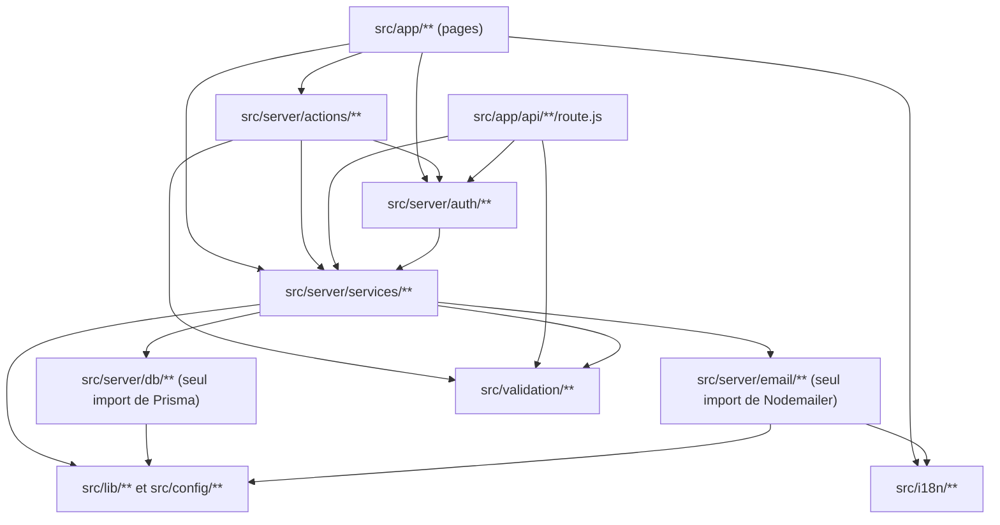
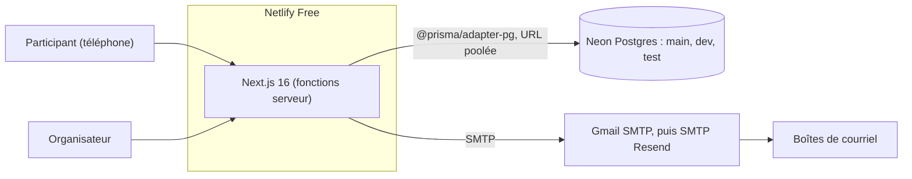
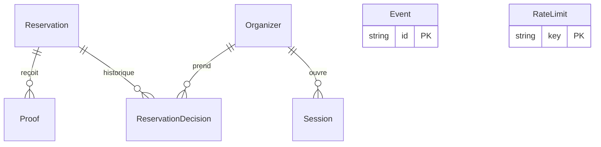

# Architecture Spine — Site de réservation du dîner de Noël

## Design Paradigm

**Architecture en couches**, celle du squelette A de `AGENTS.md` [ADOPTED]. Une requête suit toujours le même chemin : **entrée → service → accès aux données**.

| Couche | Dossier | Rôle |
| --- | --- | --- |
| Entrées | `src/app/**` (pages, `route.js`), `src/server/actions/**` | Valider avec Zod, appeler un service, mettre en forme la réponse |
| Accès protégé | `src/server/auth/**` | Lire le cookie de session et vérifier l'organisateur, pour les entrées admin |
| Services | `src/server/services/**` | Règles métier ; ne connaissent ni `Request`, ni `Response`, ni `next/*` |
| Adaptateurs | `src/server/db/**` (Prisma), `src/server/email/**` (SMTP) | Seuls points de contact avec la base et le courriel |
| Partagé | `src/validation/**`, `src/i18n/**`, `src/lib/**`, `src/config/**` | Schémas Zod et `@typedef`, dictionnaires, dates, formats, journal, variables d'environnement |

## Invariants & Rules



### AD-1 — Sens des dépendances entre couches [ADOPTED]

- **Binds:** all
- **Prevents:** une règle métier écrite dans une page ou une action ; Prisma ou Nodemailer importés hors de leur adaptateur ; un service qui lit les cookies ou les en-têtes.
- **Rule:** Les dépendances suivent uniquement les flèches du diagramme ci-dessus. Seul `src/server/db/**` importe `@prisma/client` ou `@prisma/adapter-pg`. Seul `src/server/email/**` importe `nodemailer`. Les services n'importent jamais `next/*`. Une entrée appelle un service, jamais `db/` directement. `src/validation/**` n'importe rien de `src/server/**`.

### AD-2 — Une seule enveloppe de réponse et un seul convertisseur d'erreurs

- **Binds:** les Route Handlers et les Server Actions
- **Prevents:** chaque formulaire qui lit ses résultats à sa façon ; une trace de pile ou un message de la base envoyé au navigateur.
- **Rule:**
  - Une erreur prévue est lancée avec `new AppError(statusCode, code, messageKey)`.
  - `handleApiError(error, { lang })` dans `src/server/errors/` est le seul endroit qui transforme une erreur en `{ status, body }`, avec `body = { error: { code, message, details? } }` et `message` traduit dans la langue de la requête.
  - Un Route Handler répond `NextResponse.json(body, { status })`. Une Server Action renvoie l'objet `body` lui-même et ne lance jamais d'erreur vers le client.
  - Un succès vaut `{ data }`, ou `{ data, meta }` pour une liste.
  - Toute erreur inconnue devient `500 INTERNAL_ERROR` avec un message générique, et elle est journalisée.
  - Seule exception : l'export CSV (AD-15) renvoie du `text/csv`.

### AD-3 — Deux langues, une seule source de texte

- **Binds:** les pages publiques, les courriels, les messages de validation
- **Prevents:** du français écrit en dur dans un composant public ; des messages Zod dans une seule langue ; un courriel envoyé dans la mauvaise langue.
- **Rule:**
  - Les pages publiques vivent sous `src/app/[lang]/`, avec `lang` ∈ `fr | en`, et `generateStaticParams` renvoie les deux langues.
  - `src/proxy.js` redirige seulement les adresses sans langue vers `/fr` ou `/en` (selon `Accept-Language`, `fr` par défaut). Il ne fait rien d'autre.
  - Tout texte public vient de `src/i18n/dictionaries/{fr,en}.json` par `getDictionary(lang)`. Les deux fichiers ont exactement les mêmes clés, ce qu'un test unitaire vérifie.
  - Les schémas Zod, `AppError` et les motifs de refus portent des **clés** de dictionnaire, jamais des phrases.
  - Montants et dates s'affichent par `src/lib/format.js` avec `Intl`, en `fr-CA` ou `en-CA`.
  - La réservation enregistre la langue de la page où elle a été créée. Tout courriel au participant utilise cette langue.
  - Le tableau de bord `/admin` est en français écrit directement, sans dictionnaire [ASSUMPTION]. Ses messages d'erreur passent quand même par `handleApiError` avec `lang: 'fr'` (AD-2).

### AD-4 — Une seule machine à états de la réservation

- **Binds:** la réservation, le dépôt de preuve, les décisions des organisateurs, le tableau de bord
- **Prevents:** deux fonctionnalités qui autorisent des transitions différentes, ou qui comptent les places différemment.
- **Rule:** Les statuts sont `PENDING_PAYMENT`, `TO_VERIFY`, `CONFIRMED` et `CANCELLED`, et il n'y a pas de statut « refusé ». Les seules transitions autorisées sont définies dans `src/server/services/reservation-status.service.js` :

  | De | Vers | Déclencheur | Décision enregistrée |
  | --- | --- | --- | --- |
  | `PENDING_PAYMENT` | `TO_VERIFY` | Le participant dépose une capture | — |
  | `TO_VERIFY` | `CONFIRMED` | Un organisateur confirme [ASSUMPTION : jamais sans capture] | `CONFIRM` |
  | `TO_VERIFY` | `PENDING_PAYMENT` | Un organisateur refuse, avec un code de motif | `REFUSE` + `reasonCode` |
  | `PENDING_PAYMENT`, `TO_VERIFY` | `CANCELLED` | Un organisateur annule | `CANCEL` |

  `CONFIRMED` est un état final, comme `CANCELLED` : à la demande du propriétaire (17 novembre 2026), une réservation confirmée ne peut plus être annulée.

  Une place est comptée si et seulement si `status !== CANCELLED`. Le total des places prises n'est calculé que par `sumTakenSeats()` (`src/server/db/reservation.repository.js`). Cette même fonction sert à la transaction verrouillée (AD-5) et à l'affichage des places restantes. Chaque décision écrit une ligne `ReservationDecision` (type, organisateur, date, motif) dans la même transaction que le changement de statut. Les codes de motif sont `NO_TRANSFER`, `INCOMPLETE_AMOUNT` et `UNREADABLE_PROOF` (liste à confirmer, brief §15.3).

### AD-5 — Écritures concurrentes

- **Binds:** la création de réservation, toutes les transitions de l'AD-4, la baisse du nombre de places
- **Prevents:** une place vendue en trop ; deux organisateurs qui décident en même temps sur la même réservation ; un nombre de places descendu sous les places déjà prises.
- **Rule:**
  - **Places.** La création d'une réservation et la modification du nombre de places s'exécutent dans une transaction interactive Prisma. Elle verrouille d'abord la ligne `Event` (`SELECT … FOR UPDATE` par `$queryRaw` paramétré, dans `db/`), puis additionne les places des réservations non annulées avant d'écrire.
  - **Changements de statut.** Chaque transition est une mise à jour conditionnelle `WHERE id = ? AND status = <statut attendu>` (`updateMany`). Si aucune ligne n'est modifiée, l'erreur est `AppError(409, 'RESERVATION_STATUS_CHANGED')`.
  - **Même transaction.** La ligne de décision (AD-4) et la ligne de capture (AD-8) s'écrivent dans la transaction qui change le statut.
  - **Rien d'externe en transaction.** Aucun appel externe (courriel, `sharp`) ne se fait à l'intérieur d'une transaction.

### AD-6 — Argent et valeurs figées

- **Binds:** la réservation, l'état des comptes, les courriels, l'export
- **Prevents:** des arrondis ; un ancien inscrit dont le montant change avec les paramètres ; deux définitions de « montant encaissé ».
- **Rule:**
  - Les montants sont des entiers en cents, dans des champs suffixés `Cents`.
  - À la création, la réservation copie `unitPriceCents`, `amountCents` et `interacEmail`, et ne les recalcule jamais.
  - `confirmedAt` est rempli à la première confirmation et n'est jamais effacé.
  - **Encaissé** = somme des `amountCents` où `confirmedAt` est rempli. **En attente** = somme des `amountCents` des statuts `PENDING_PAYMENT` et `TO_VERIFY`.
  - Ces deux sommes n'existent que dans `src/server/services/accounting.service.js`.

### AD-7 — Lien personnel du participant

- **Binds:** la page de paiement, le dépôt de preuve, les courriels
- **Prevents:** un lien devinable ; un courriel de refus qui ne peut pas redonner le même lien ; un lien qui donne accès à autre chose que sa réservation.
- **Rule:**
  - Le jeton fait 32 octets aléatoires (`node:crypto`) en base64url. Il est unique et stocké **en clair** sur la réservation, parce que les courriels doivent pouvoir le redonner.
  - La page `/[lang]/r/[token]` affiche à la fois le paiement, le dépôt et le statut. C'est l'adresse vers laquelle le participant est envoyé juste après sa réservation.
  - Elle n'accepte une capture que si le statut est `PENDING_PAYMENT`.
  - Le jeton n'est jamais journalisé. Les liens sont reconstruits à partir de `SITE_URL`, de la langue de la réservation et du jeton.

### AD-8 — Captures de paiement privées

- **Binds:** le dépôt de preuve, la fiche de réservation
- **Prevents:** une capture accessible par une adresse publique ; un faux fichier image accepté ; une capture écrasée par un complément.
- **Rule:**
  - **Dépôt.** Le participant dépose sa capture par le Route Handler `POST /api/reservations/[token]/proofs` (multipart), jamais par une Server Action. La taille maximale est de 4 Mo [ASSUMPTION].
  - **Vérification.** `sharp` décode le fichier, ce qui vérifie le vrai type (JPG, PNG ou WEBP) quelle que soit l'extension. Il le réencode ensuite en WebP (côté long de 2 000 px au maximum), ce qui retire les métadonnées.
  - **Stockage.** La capture est enregistrée en octets dans une ligne `Proof` liée à la réservation. Elle n'est jamais modifiée ni supprimée.
  - **Lecture.** On ne la lit que par `GET /api/admin/proofs/[id]`, après `requireOrganizer()`, avec `Cache-Control: private, no-store`. Jamais de fichier dans `public/`, jamais d'URL publique.

### AD-9 — Connexion des organisateurs

- **Binds:** tout `/admin`, `/api/admin/**` et les Server Actions des organisateurs
- **Prevents:** une page admin oubliée sans contrôle ; un contrôle fait seulement dans le proxy ; des mots de passe ou des jetons de session stockés en clair.
- **Rule:**
  - **Tables.** `Organizer` contient `email` et `passwordHash` (bcryptjs, coût 12). `Session` contient `tokenHash` (SHA-256 du jeton), `organizerId` et `expiresAt`.
  - **Cookie.** Le cookie `session` est `httpOnly`, `Secure` en production, `SameSite=Lax` et `Path=/`. Il dure 30 jours et est prolongé quand il reste moins de 15 jours. La déconnexion supprime la ligne de session.
  - **Contrôle.** `requireOrganizer()` (`src/server/auth/`) est appelé en tête de **chaque** page admin, action admin et route admin. Le proxy ne décide jamais d'un accès.
  - **Comptes.** Il n'y a pas d'inscription : les comptes sont créés par `scripts/create-organizer.js`.
  - **Tentatives.** Les tentatives de connexion sont limitées (AD-11).

### AD-10 — Courriels

- **Binds:** les 3 courriels aux participants
- **Prevents:** un fournisseur de courriel inscrit dans le code ; une réservation annulée parce qu'un courriel a échoué ; un courriel envoyé alors que la transaction est ensuite annulée.
- **Rule:**
  - **Envoi.** Un seul point d'envoi existe : `sendEmail({ to, subject, text, html })` dans `src/server/email/`. Il passe par Nodemailer en SMTP, configuré seulement par l'environnement (`SMTP_HOST`, `SMTP_PORT`, `SMTP_USER`, `SMTP_PASSWORD`, `EMAIL_FROM`). Changer de fournisseur ne demande donc aucune ligne de code.
  - **Modèles.** Chaque courriel est construit par une fonction de `src/server/email/templates/` qui renvoie `{ subject, text, html }` à partir des données et du dictionnaire.
  - **Moment.** Le service envoie le courriel **après** le commit.
  - **Échec.** Un échec est journalisé avec l'identifiant de la réservation, sans nom ni courriel. L'action déjà faite reste valide.
  - **Suivi des échecs.** Depuis le 17 novembre 2026, chaque échec est aussi enregistré dans la table `EmailFailure` (réservation, type `RECEIPT`, `CONFIRMATION` ou `REFUSAL`, date) par `src/server/services/email-failure.service.js`. Cette écriture ne lance jamais d'erreur. La vue d'ensemble et la fiche signalent l'échec à chaque visite, jusqu'à ce qu'un organisateur clique sur « J'ai prévenu la personne ». La ligne n'est jamais supprimée : `resolvedAt` et `resolvedById` notent qui l'a traitée, et quand. L'ancien avis passé par un paramètre d'adresse (`?courriel=non-envoye`) est retiré.
  - **Tests.** Les tests simulent `sendEmail`.

### AD-11 — Limite de requêtes

- **Binds:** la création de réservation, le dépôt de preuve, la connexion
- **Prevents:** des envois en masse ; trois façons différentes de limiter les requêtes ; une adresse IP lue différemment selon les routes.
- **Rule:**
  - Une seule fonction limite les requêtes : `checkRateLimit({ key, limit, windowSeconds })` (service), sur une table `RateLimit` à fenêtre fixe.
  - Les clés sont `reserve:<ip>`, `proof:<ip>` et `login:<ip>`.
  - L'adresse IP est lue seulement par `src/lib/client-ip.js`, d'abord dans `x-nf-client-connection-ip`, sinon dans `x-forwarded-for`.
  - Au-delà de la limite : `429 TOO_MANY_REQUESTS`.

### AD-12 — Heure et fuseau

- **Binds:** les paramètres, la date limite, le compte à rebours, les courriels
- **Prevents:** une date limite décalée de 5 heures ou un affichage dans le mauvais fuseau.
- **Rule:**
  - **Stockage et affichage.** La base stocke de l'UTC. L'heure de l'événement, la saisie et l'affichage sont à l'heure d'Ottawa, avec la constante `EVENT_TIME_ZONE = 'America/Toronto'`.
  - **Un seul module.** Toute conversion entre heure locale et UTC passe par `src/lib/dates.js` (`@date-fns/tz`).
  - **Horloge injectable.** Un service qui dépend de l'heure reçoit `now` en paramètre ; c'est l'entrée qui fournit `new Date()`.

### AD-13 — Retirée du périmètre le 16 novembre 2026

À la demande du propriétaire, l’alerte aux organisateurs (R19) et l’annulation automatique de la veille (R20) sont annulées. Aucun déclencheur planifié, route cron, secret de planification ni bandeau d’alerte de clôture n’est requis. Les réservations non confirmées restent actives jusqu’à une décision manuelle. L’identifiant AD-13 est conservé pour la traçabilité.

Les champs techniques existants `Event.alertSentAt` et `DecisionType.AUTO_CANCEL` sont des vestiges du schéma initial, sans exigence fonctionnelle active. Ce changement de périmètre ne nécessite pas de migration.

### AD-14 — Un seul événement et ses paramètres

- **Binds:** l'accueil, la réservation, les paramètres
- **Prevents:** deux sources de vérité pour le prix ou les dates ; une date limite placée après l'événement.
- **Rule:**
  - La base contient exactement une ligne `Event`, créée par `prisma/seed.js`, et chaque service la lit par `getEvent()`.
  - Toute modification passe par un seul service, qui vérifie deux choses : la date limite tombe avant l'événement, et le nombre de places n'est pas sous les places prises (avec le verrou de l'AD-5).
  - Une modification ne touche jamais les réservations existantes (AD-6).
  - Le dépôt automatique Interac est obligatoire : il n'y a aucun champ de question de sécurité [ASSUMPTION, brief §15.6].

### AD-15 — Rendu avec `cacheComponents` [ADOPTED]

- **Binds:** toutes les pages
- **Prevents:** des places restantes ou un statut affichés depuis un cache périmé ; des erreurs de build sur des données non mises en cache lues hors `<Suspense>`.
- **Rule:**
  - Aucune fonction ni aucun composant qui lit `Reservation`, `Proof`, `Session` ou le nombre de places ne porte `"use cache"`.
  - Ces lectures se font dans des composants dynamiques placés sous `<Suspense>`.
  - Seuls les dictionnaires, les photos et le texte fixe peuvent être mis en cache.
  - L'export CSV `GET /api/admin/exports/confirmed-participants` lit toujours la base au moment de la requête.

### AD-16 — Environnements et déploiement

- **Binds:** la configuration, les migrations, les déploiements
- **Prevents:** un aperçu Netlify qui écrit dans la base de production ; une migration lancée par un build ; les crédits gratuits épuisés en pleine période de réservation.
- **Rule:**
  - **Bases de données.**

    | Environnement | Base Neon |
    | --- | --- |
    | Local et aperçus Netlify (deploy previews) | branche `dev` |
    | Tests Vitest et Playwright | branche `test` |
    | Production | branche principale |

  - **Secrets.** Les secrets sont dans les variables d'environnement Netlify, définies pour chaque contexte. `src/config/env.js` les vérifie toutes avec Zod au démarrage.
  - **Migrations.** `prisma migrate deploy` se lance **à la main**, avec l'accord de l'utilisateur, avant le déploiement qui en a besoin. Jamais dans le build Netlify.
  - **Déploiements de production.** Chacun coûte 15 des 300 crédits mensuels, alors on les regroupe, avec au plus environ 10 par mois. Les aperçus sont gratuits.

### AD-17 — Un seul propriétaire du schéma de données

- **Binds:** `prisma/schema.prisma`, `prisma/migrations/`, toutes les stories
- **Prevents:** deux stories en parallèle qui créent des migrations en conflit, ou qui nomment différemment les mêmes champs.
- **Rule:**
  - **Schéma initial.** La première story, la fondation, crée le schéma complet des modèles connus (Données, ci-dessous) avec tous leurs champs, en une seule migration initiale.
  - **Champs de la réservation.** `firstName`, `lastName`, `email`, `phone`, `seats`, `note`, `language`, `code`, `token`, `status`, `unitPriceCents`, `amountCents`, `interacEmail`, `confirmedAt`, `createdAt`.
  - **Stories suivantes.** Au plus une migration par story, créée seulement après avoir récupéré la dernière migration de `main`. Une migration déjà appliquée n'est jamais modifiée (`AGENTS.md`).

## Consistency Conventions

| Concern | Convention |
| --- | --- |
| Nommage [ADOPTED] | Règles de `AGENTS.md` : code en anglais, fichiers en kebab-case avec leur rôle (`reservation.service.js`, `reservation.repository.js`, `reservation.schema.js`, `reservation.actions.js`), composants en `PascalCase.jsx`, modèles Prisma au singulier en PascalCase (`Event`, `Reservation`, `Proof`, `ReservationDecision`, `Organizer`, `Session`, `RateLimit`), énumérations et codes d'erreur en `UPPER_SNAKE_CASE` (`SOLD_OUT`, `BOOKING_CLOSED`, `RESERVATION_NOT_FOUND`, `RESERVATION_STATUS_CHANGED`, `INVALID_CREDENTIALS`, `PROOF_TOO_LARGE`, `PROOF_INVALID_TYPE`) |
| Identifiants | `String @id @default(cuid())`. Code public `NOEL-` + 4 chiffres aléatoires, avec une contrainte d'unicité et un nouvel essai en cas de collision |
| Données et formats | Argent en cents entiers (AD-6). `DateTime` en UTC en base et en ISO 8601 UTC dans le JSON (AD-12). Clés JSON en camelCase |
| Validation | Un schéma Zod par entrée dans `src/validation/*.schema.js`, avec son `@typedef`, réutilisé par le formulaire et par l'entrée serveur. Les messages sont des clés de dictionnaire (AD-3) |
| Formulaires | Server Action et `useActionState`. La réponse suit l'enveloppe de l'AD-2. Seul le dépôt de capture passe par `fetch` vers le Route Handler (AD-8) |
| Configuration | `src/config/env.js` est le seul à lire `process.env`. `.env.example` liste toutes les variables : `DATABASE_URL` (URL poolée), `DIRECT_URL` (migrations), `SITE_URL`, `SMTP_HOST`, `SMTP_PORT`, `SMTP_USER`, `SMTP_PASSWORD`, `EMAIL_FROM` |
| Journalisation | `src/lib/logger.js` seulement. On journalise l'identifiant de la réservation et le code d'erreur. Jamais de nom, de courriel, de téléphone, de jeton, de mot de passe ni de capture |
| Styles | CSS Modules et variables CSS dans `src/app/globals.css` [ADOPTED du starter]. Couleurs, tailles de texte et contrastes (brief §10) sont définis une seule fois comme variables. Ni dégradé ni emoji. Icônes `lucide-react`. Polices chargées une seule fois par `next/font` dans le layout racine (proposition : EB Garamond pour les titres, Source Sans 3 pour le texte). Animations en CSS seulement, désactivées sous `prefers-reduced-motion: reduce` |
| Dépendances | Versions exactes, sans `^`. `prisma` doit être installé en `7.10.1` explicitement, parce que son tag npm `latest` pointe sur une version candidate de Prisma 8. Chaque ajout est demandé avant (`AGENTS.md`) |
| Tests | Tests Vitest à côté des fichiers, sur la branche Neon `test`, avec des données fictives uniquement (seed compris). `sendEmail` et l'horloge (`now`) sont simulés. Parcours Playwright : réserver → déposer → confirmer, en `fr` et en `en` |

## Stack

| Name | Version |
| --- | --- |
| Node.js | 24 (LTS) |
| Next.js | 16.4.6 |
| React / React DOM | 19.3.0 |
| babel-plugin-react-compiler | 1.0.0 |
| prisma / @prisma/client / @prisma/adapter-pg | 7.10.1 |
| PostgreSQL | Neon, offre gratuite (1 Go) |
| zod | 4.6.7 |
| bcryptjs | 3.0.3 |
| nodemailer | 10.6.0 |
| sharp | 0.35.5 |
| @date-fns/tz | 1.5.0 |
| lucide-react | 1.73.0 |
| vitest | 5.1.0 |
| @testing-library/react | 16.3.3 |
| @playwright/test | 1.65.1 |
| prettier | 3.10.1 |
| eslint-config-prettier | 10.1.8 |
| Hébergement | Netlify Free, @netlify/plugin-nextjs 5.16.7 |

## Structural Seed

### Déploiement



### Données



### Arborescence

```text
src/
  proxy.js                     # redirige vers /fr ou /en, rien d'autre (AD-3)
  app/
    [lang]/                    # accueil, réservation, r/[token] = paiement + dépôt + statut
    admin/                     # tableau de bord en français, requireOrganizer() partout
    api/
      reservations/[token]/proofs/route.js           # dépôt d'une capture (AD-8)
      admin/proofs/[id]/route.js                     # lecture d'une capture (AD-8, AD-9)
      admin/exports/confirmed-participants/route.js  # export CSV
  components/ui/  components/reservations/  components/admin/
  i18n/dictionaries/fr.json  en.json   i18n/get-dictionary.js
  validation/                  # *.schema.js + @typedef
  server/
    actions/                   # réserver, se connecter, confirmer, refuser, annuler, paramètres
    auth/                      # require-organizer.js
    services/                  # reservation, reservation-status, proof, event, accounting, auth, rate-limit
    db/                        # client Prisma + *.repository.js
    email/                     # send-email.js + templates/
    errors/                    # AppError, handleApiError
  config/env.js
  lib/                         # dates.js, format.js, logger.js, client-ip.js
prisma/schema.prisma  prisma/seed.js
scripts/create-organizer.js
e2e/
```

## Capability → Architecture Map

| Brief | Lives in | Governed by |
| --- | --- | --- |
| §4.1–4.5, §8 : réserver, capacité, code, fermeture | `server/actions` → `reservation.service` → `db` | AD-4, AD-5, AD-6, AD-11, AD-14 |
| §4.5–4.9 : page de paiement, lien personnel | `app/[lang]/r/[token]` | AD-3, AD-7, AD-15 |
| §4.8, §12 : dépôt de capture privé | `api/reservations/[token]/proofs`, `proof.service` | AD-5, AD-8, AD-11 |
| §4.11, §5.6–5.7 : confirmer, refuser, annuler | `app/admin`, `reservation-status.service` | AD-4, AD-5, AD-9 |
| §5.2, §6 : compteurs, état des comptes | `accounting.service` | AD-6, AD-15 |
| §5.8, §8 : paramètres de l'événement | `app/admin`, `event.service` | AD-5, AD-12, AD-14 |
| §6 : courriels aux participants | `server/email` | AD-3, AD-10 |
| §6 : export CSV des confirmés | `api/admin/exports/confirmed-participants` | AD-2, AD-9, AD-15 |
| §3, §6 : bilingue | `app/[lang]`, `i18n` | AD-3 |
| §12 : sécurité, limites, données personnelles | transverse | AD-8, AD-9, AD-11, conventions de journalisation |
| §17 : calendrier, crédits gratuits | Netlify, Neon | AD-16 |

## Deferred

- **Passage à Resend (SMTP).** Les courriels partent d'un compte Gmail dédié, avec la double authentification et un mot de passe d'application. À revoir dès que l'église contrôle un domaine et ses DNS : il suffit de changer les variables `SMTP_*` (AD-10).
- **Compression de l'image dans le navigateur.** À revoir si des participants dépassent 4 Mo.
- **Nouvel essai et file d'envoi des courriels.** À revoir au premier échec d'envoi journalisé.
- **Réinitialisation du mot de passe par écran.** À revoir si un organisateur oublie son mot de passe plus d'une fois ; d'ici là, on relance le script.
- **Surveillance et alertes techniques au-delà des journaux Netlify.** À revoir si le site doit durer au-delà de décembre.
- **Sauvegarde et durée de conservation des données après le dîner.** À revoir avant le 31 décembre 2026 : export de la base et durée à fixer avec l'organisation.
- **Tableau de bord bilingue.** À revoir si un organisateur anglophone rejoint l'équipe.
- **Confirmer sans capture**, quand le virement est arrivé mais qu'aucune preuve n'a été déposée. C'est une question ouverte pour les organisateurs ; d'ici là, AD-4 l'interdit.
- **Mise en place des outils**, à faire dans la première story avec l'accord de l'utilisateur, parce que c'est de la configuration selon `AGENTS.md` :
  - `"checkJs": true` dans `jsconfig.json` ;
  - `"type": "module"` dans `package.json` ;
  - Prettier, Vitest et Playwright ;
  - les scripts `test`, `test:e2e` et `format` ;
  - `netlify.toml`.
