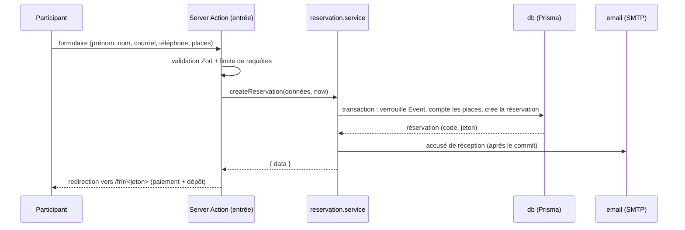

# Guide du développeur — Site de réservation du dîner de Noël

Ce guide explique l'architecture à une personne qui rejoint le projet. La référence qui fait foi reste le document court
`architecture-reservation-diner-noel.md` (les décisions `AD-1` à `AD-17`). Ce guide en donne les raisons.

## En une minute

- **Le site** : les participants réservent des places pour le dîner de Noël, paient par virement Interac et déposent
  une capture d'écran du virement. Quatre organisateurs vérifient chaque virement et confirment la place.
- **La technique** : Next.js 16 (App Router) en JavaScript, PostgreSQL sur Neon par Prisma 7, validation Zod.
  Le site est hébergé sur Netlify Free et les courriels partent en SMTP.
- **Le budget** : 0 $ par mois. Plusieurs choix en découlent directement.
- **Le calendrier** : mise en ligne le vendredi 20 novembre 2026. Les fonctionnalités arrivent selon la date où elles deviennent utiles
  (brief, section 17).

## Le chemin d'une requête

Toute requête suit le même chemin : **entrée → service → base**. Voici l'exemple d'une réservation.

Ce qu'il faut retenir :

- **L'entrée** (page, Server Action ou `route.js`) valide les données et appelle un seul service. Elle ne contient aucune règle métier.
- **Le service** applique les règles : places, statuts, montants. Il ne connaît ni les cookies, ni `Request`.
- **`src/server/db/`** est le seul dossier qui parle à Prisma, et **`src/server/email/`** le seul qui envoie des courriels.

## Pourquoi ces choix

| Sujet | Choix | Écarté | Pourquoi |
| --- | --- | --- | --- |
| Hébergement | Netlify Free | Vercel Hobby, Cloudflare Workers, Render | Vercel Hobby interdit l'usage commercial, et un site qui demande des paiements en relève. Netlify Free l'autorise. Cloudflare est plus risqué avec Prisma. Render met du temps à démarrer après une période sans visite. |
| Captures d'écran | Dans Postgres, réencodées en WebP par `sharp` | Netlify Blobs, Vercel Blob, Cloudflare R2 | C'est privé par construction et enregistré dans la même transaction que le statut. Ça marche pareil en local et en test. Une fois réencodées, environ 200 captures tiennent largement dans 1 Go. |
| Dépôt de la capture | Route Handler | Server Action | Une Server Action est limitée à 1 Mo par défaut, et changer cette limite modifie `next.config`. |
| Courriels | Nodemailer en SMTP, fournisseur choisi par configuration | SDK propre à un fournisseur | On peut commencer avec Gmail et passer à Resend quand l'église aura un domaine, sans toucher au code. |
| Connexion | Sessions en base, faites à la main (bcryptjs + cookie) | Better Auth, Auth.js | Il n'y a que 4 comptes, et c'est environ 3 petits fichiers lisibles. La bibliothèque Lucia, qui servait à ça, est devenue un guide pour le faire soi-même. |
| Langues | Segment `[lang]` avec deux dictionnaires JSON | next-intl | Aucune dépendance de plus, et pas de risque avec `cacheComponents`. |
| Tâches automatiques | Une route idempotente appelée chaque heure | Une logique dans la fonction Netlify | Une seule façon de faire. On peut changer de planificateur sans changer le code. |
| Places vendues en trop | Verrou sur la ligne `Event` dans une transaction | Un compteur séparé | Une seule source de vérité : les réservations elles-mêmes. |

## Les règles à ne jamais casser

1. **Une place est prise dès la réservation** et libérée seulement par une annulation. Un refus remet la réservation
   « En attente de paiement » sans libérer ses places (AD-4).
2. **Tout changement de statut est conditionnel** au statut attendu. Si deux organisateurs cliquent en même temps,
   le second reçoit `409 RESERVATION_STATUS_CHANGED` (AD-5).
3. **L'argent est en cents entiers**, et le prix est copié dans la réservation au moment où elle est créée (AD-6).
4. **Une capture n'a jamais d'adresse publique** : on ne la lit que par une route réservée aux organisateurs (AD-8).
5. **Chaque page et chaque action admin appelle `requireOrganizer()`**. Le proxy ne protège rien (AD-9).
6. **Aucun texte public écrit en dur** : tout passe par les dictionnaires `fr` et `en`, qui ont les mêmes clés (AD-3).
7. **Aucun `"use cache"` sur des données qui changent** : réservations, places, sessions (AD-15).
8. **Les heures sont stockées en UTC** et converties à l'heure d'Ottawa uniquement dans `src/lib/dates.js` (AD-12).

## Les trois environnements

| Environnement | Base Neon | Déploiement |
| --- | --- | --- |
| Local et aperçus Netlify | branche `dev` | aperçus gratuits et illimités |
| Tests (Vitest, Playwright) | branche `test` | — |
| Production | branche principale | 15 crédits par déploiement, sur 300 par mois |

Les migrations se lancent **à la main** (`prisma migrate deploy`), jamais pendant le build.

## Pièges connus

- **`npm i prisma` installe une version candidate de Prisma 8.** Il faut toujours écrire la version : `prisma@7.10.1`.
- **Crédits Netlify** : quand les 300 crédits sont épuisés, le site est mis en pause. On regroupe donc les déploiements de production.
- **`cacheComponents` est activé** : une lecture de la base hors `<Suspense>` fait échouer le build.
- **Captures de 4 Mo au maximum**, pour rester sous la limite de taille des fonctions serveur.
- **Gmail** exige la double authentification pour créer un mot de passe d'application, et il plafonne à environ 500 destinataires par jour.
- **Fonction planifiée** : elle ne tourne qu'en production. Si elle ne se déclenche pas, un planificateur externe peut appeler la même route.

## Où trouver quoi

- Le besoin : `docs/projet-brief.md`
- Les règles de code : `AGENTS.md`
- Les décisions : `architecture-reservation-diner-noel.md`
- L'historique des décisions et de leurs raisons : `.memlog.md`, dans ce dossier
- Les relectures du document : `reviews/`
